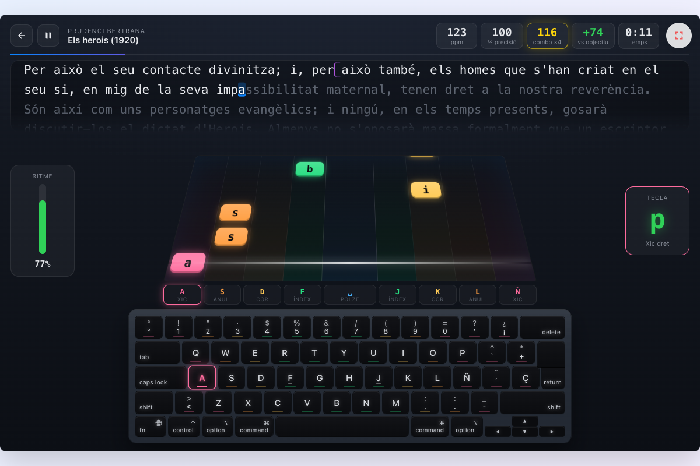
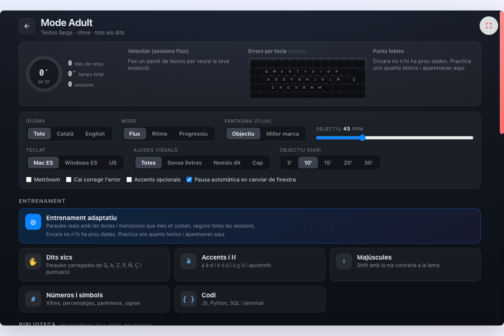
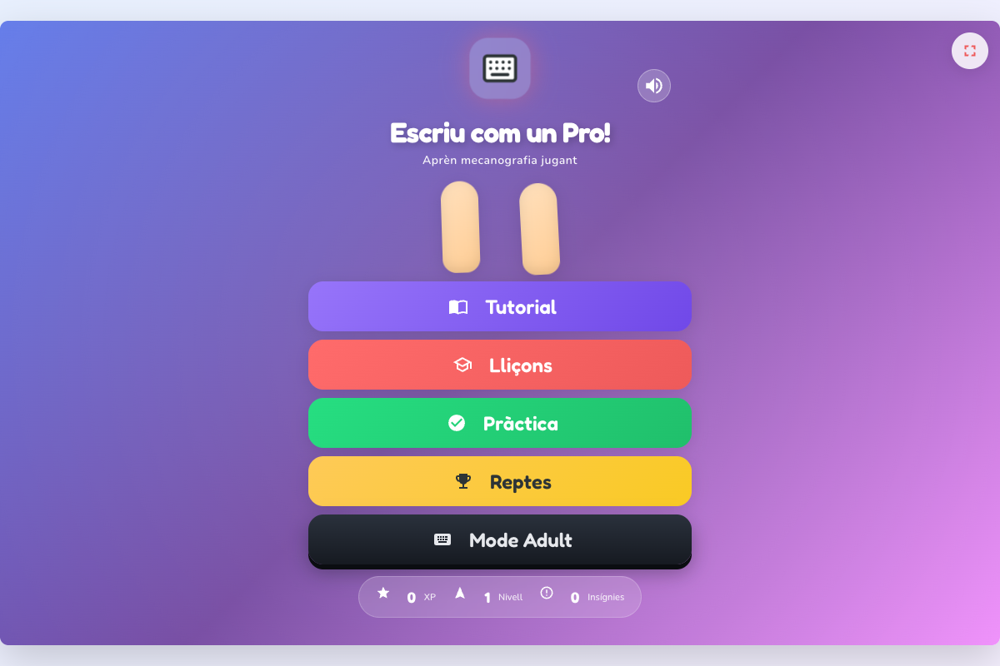
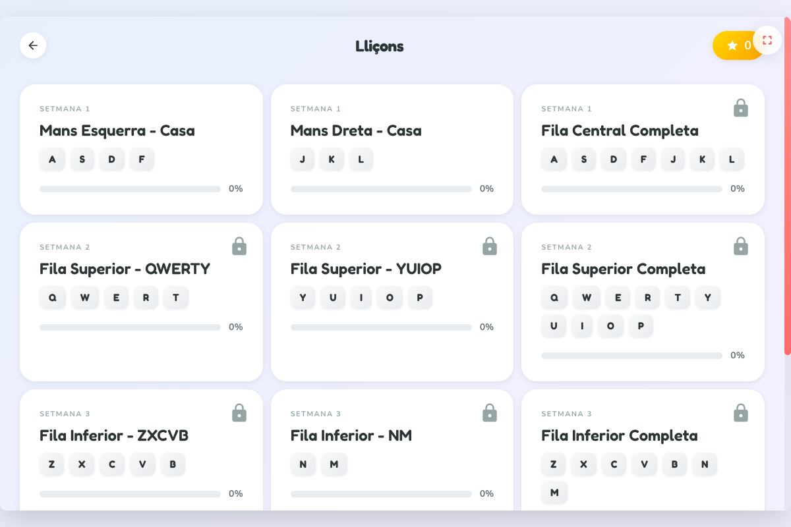
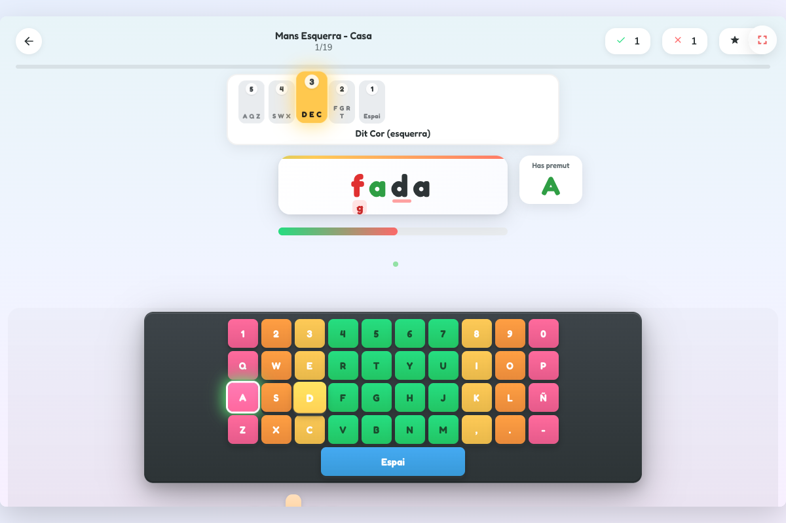
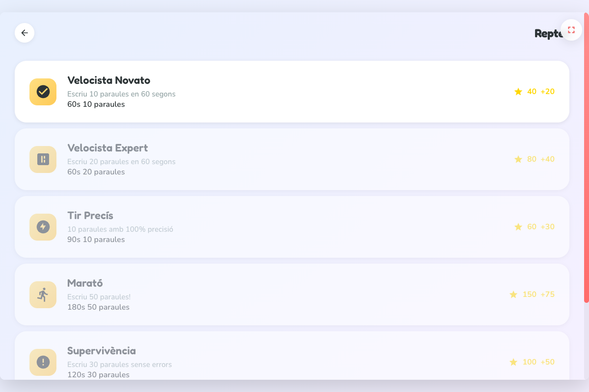
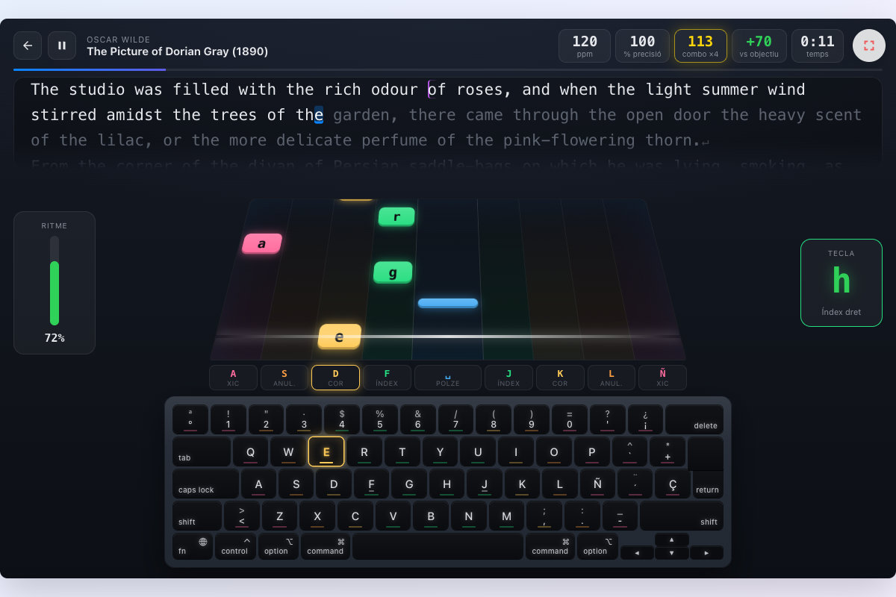

# Escriu com un Pro! · Typing Tutor

[Català](#català) · [English](#english)

---

## Català



**Escriu com un Pro!** és una aplicació web per aprendre mecanografia. Té dos mons en un: un **Mode Adult** de tema fosc, amb textos llargs i estadístiques detallades per guanyar velocitat, i un **mode infantil** (8-12 anys) ple de colors, lliçons i reptes. Funciona completament al navegador: sense instal·lació, sense dependències, sense servidor i sense comptes. La interfície és en català.

### Mode Adult

- **Tres modes d'entrenament:** *Flux* (amb fantasma que marca el teu objectiu o la teva millor marca), *Ritme* (les lletres cauen al ritme objectiu i es jutja la precisió temporal) i *Progressiu* (la velocitat puja fins que els errors passen del 15 %).
- **Textos de domini públic** en català i anglès (Project Gutenberg), de Maragall, Oller, Austen, Melville, Wilde, Joyce i més.
- **Importació de llibres** propis en format `.txt` o `.epub`.
- **Entrenament adaptatiu** que detecta les tecles i transicions que més et costen.
- Exercicis d'**accents**, **majúscules**, **números i símbols**, **codi** i **dits xics**.
- **Distribucions de teclat:** Mac ES, Windows ES i US.
- Estadístiques per tecla i per parell de lletres, mapa de calor del teclat, objectiu diari i pausa automàtica.

### Mode infantil

- **Tutorial** de mecanografia i **lliçons progressives** per setmanes, dits i files del teclat.
- **Guia visual de dits** amb codi de colors i teclat en pantalla.
- **Pràctica lliure** amb paraules per categories.
- **Reptes** cronometrats i **insígnies** per mantenir la motivació.
- **XP, nivells i ratxes** diàries, efectes de so (desactivables) i confeti.

Tot el progrés es desa **només al teu navegador** (`localStorage`); no s'envia cap dada a cap servidor.

### Captures de pantalla

**Mode Adult**

| Selecció de text i opcions | En joc |
|---|---|
|  |  |

**Mode infantil**

| Pantalla inicial | Lliçons |
|---|---|
|  |  |
| **Dins d'una lliçó** | **Reptes** |
|  |  |

### Com utilitzar-lo

1. Clona el repositori o descarrega'l:
   ```bash
   git clone https://github.com/albertbosch/typing-tutor.git
   cd typing-tutor
   ```
2. Obre `index.html` al navegador (doble clic o `open index.html`), o serveix la carpeta amb `python3 -m http.server`.
3. Escriu el teu nom i comença a practicar.

> Les tipografies (Fredoka i Nunito) es carreguen de Google Fonts; sense connexió s'usa una tipografia per defecte.

### Estructura

```
index.html   -> totes les pantalles
styles.css   -> estils del mode infantil
app.js       -> lògica, lliçons, reptes, insígnies i progrés
adult.css    -> estils del Mode Adult
adult.js     -> lògica del Mode Adult
texts.js     -> textos de domini públic (català i anglès)
```

### Llicència

Aquest projecte està sota llicència [CC BY-NC 4.0](https://creativecommons.org/licenses/by-nc/4.0/deed.ca): pots usar-lo i adaptar-lo citant-ne l'autoria, però no amb finalitats comercials.

---

## English



**Escriu com un Pro!** ("Type like a Pro!") is a web app for learning touch typing. It combines two worlds: a dark-themed **Adult Mode** with long texts and detailed statistics to build speed, and a colourful **kids mode** (ages 8-12) with lessons and challenges. It runs entirely in the browser: no install, no dependencies, no server, no accounts. The interface is in Catalan.

### Adult Mode

- **Three training modes:** *Flux* (with a ghost that follows your target or your best run), *Ritme* (letters fall at your target speed and timing is judged) and *Progressiu* (speed ramps up until misses exceed 15%).
- **Public-domain texts** in Catalan and English (Project Gutenberg), including Maragall, Oller, Austen, Melville, Wilde, Joyce and more.
- **Import your own books** as `.txt` or `.epub`.
- **Adaptive training** that targets the keys and transitions you struggle with most.
- Drills for **accents**, **capitals**, **numbers and symbols**, **code** and **weak fingers**.
- **Keyboard layouts:** Mac ES, Windows ES and US.
- Per-key and per-bigram statistics, keyboard heatmap, daily goal and auto-pause.

### Kids mode

- **Tutorial** and **progressive lessons** organised by week, finger and keyboard row.
- **Visual finger guide** with colour coding and an on-screen keyboard.
- **Free practice** with words grouped by category.
- Timed **challenges** and **badges** to keep learners motivated.
- **XP, levels and daily streaks**, sound effects (can be muted) and confetti.

All progress is stored **only in your browser** (`localStorage`); no data is sent anywhere.

### Screenshots

**Adult Mode**

| Text and options selection | In action |
|---|---|
|  |  |

**Kids mode**

| Home | Lessons |
|---|---|
|  |  |
| **Inside a lesson** | **Challenges** |
|  |  |

### Getting started

1. Clone or download the repository:
   ```bash
   git clone https://github.com/albertbosch/typing-tutor.git
   cd typing-tutor
   ```
2. Open `index.html` in your browser (double-click or `open index.html`), or serve the folder with `python3 -m http.server`.
3. Enter your name and start practising.

> Fonts (Fredoka and Nunito) are loaded from Google Fonts; offline, a fallback font is used.

### Structure

```
index.html   -> all screens
styles.css   -> kids mode styles
app.js       -> logic, lessons, challenges, badges and progress
adult.css    -> Adult Mode styles
adult.js     -> Adult Mode logic
texts.js     -> public-domain texts (Catalan and English)
```

### License

This project is licensed under [CC BY-NC 4.0](https://creativecommons.org/licenses/by-nc/4.0/): you may use and adapt it with attribution, but not for commercial purposes.
